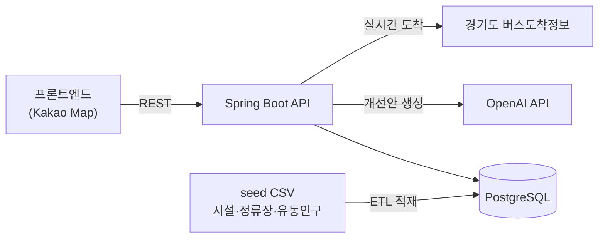

# 지금가용 백엔드

> 원하는 요일·시간에 이용 가능한 용인시 공공시설을 찾고, 이용할 수 없는 시간대에는 AI가 운영시간 개선안을 제안하는 서비스의 API 서버


**용용톤(2026-11-15) 17팀 · 트랙: 여가 생활 및 인프라**

## 목차

- [소개](#소개)
- [주요 기능](#주요-기능)
- [동작 구조](#동작-구조)
- [시작하기](#시작하기)
- [API 사용 예시](#api-사용-예시)
- [환경 변수](#환경-변수)
- [프로젝트 구조](#프로젝트-구조)
- [데이터](#데이터)
- [배포](#배포)

## 소개

공공시설은 많지만 "지금 이 시간에 갈 수 있는 곳"을 찾기는 어렵습니다. 운영시간이 요일마다 다르고, 공간(열람실, 체육관 등)마다 다르고, 휴관일과 예약 조건까지 있기 때문입니다.

**지금가용**은 용인시 공공데이터(시설, 운영시간, 교통)를 한곳에 모아 이 문제를 풉니다.

- 사용자는 요일과 시간을 고르면 그 시간에 **실제로 이용 가능한 시설**을 봅니다.
- 이용할 수 없는 시설은 **왜 이용할 수 없는지**, 어떻게 바뀌면 이용할 수 있는지를 AI 개선안으로 확인합니다.
- 개선안은 운영시간 차이뿐 아니라 같은 행정구 시설과의 비교, 경기도 유동인구 통계, 주변 교통 정보를 근거로 합니다.

지도는 프론트엔드의 Kakao Map SDK가 그리고, 이 서버는 시설 좌표와 데이터를 제공합니다.

## 주요 기능

| ID | 기능 | Method | Endpoint |
|---|---|---|---|
| A01 | 검색 선택지 조회 | GET | `/api/v1/facility-search-options` |
| A02 | 시간대별 시설 검색 | GET | `/api/v1/facilities` |
| A03 | 시설 상세 및 공간별 운영시간 | GET | `/api/v1/facilities/{facilityId}` |
| A04 | 공간별 불일치 분석 및 AI 개선안 | POST | `/api/v1/improvement-analyses` |
| A05 | 시설 교통 접근성(반경 500m 정류장 수) | GET | `/api/v1/facilities/{facilityId}/transport-accessibility` |
| A06 | 시설 주변 실시간 버스 도착 | GET | `/api/v1/facilities/{facilityId}/bus-arrivals` |

요청·응답 형식은 [API 명세서](docs/06_API_명세서.md)와 [공통 규칙](docs/07_API_공통규칙_응답타입.md)을 따릅니다. 성공 응답은 모두 `{ "data": ..., "meta": ... }` 봉투이고 JSON 필드는 camelCase입니다.

## 동작 구조

### 전체 흐름



### AI 개선안(A04)

AI가 자유롭게 말하지 않도록, **서버가 먼저 사실을 계산하고 AI는 그 사실을 근거로만 제안**합니다.

1. **관찰 계산**: 서버가 시설 데이터에서 "관찰"을 만듭니다. 희망 시간과 운영시간의 차이, 휴관일, 예약 필요, 같은 행정구·같은 유형 시설과의 운영시간 비교, 경기도 구 단위 유동인구 통계와의 비교, 주변 정류장 수 등입니다. 비교 결과는 부족할 때뿐 아니라 충족할 때도 알려 줍니다.
2. **AI 제안**: OpenAI Responses API가 관찰 id를 근거로 개선안을 JSON으로만 답합니다.
3. **서버 검증**: 근거 id가 실제 존재하는지, 입력에 없는 숫자나 금지 표현이 없는지, 제안 마감 시각이 규칙에 맞는지 확인합니다. 검증에 실패한 결과는 저장하지 않습니다.
4. **캐시**: 결과를 `ai_analysis` 테이블에 저장합니다. 입력, 모델, 프롬프트 버전이 같으면 AI를 다시 부르지 않습니다.

AI 호출에는 개인·IP·서버 전체 단위 한도가 있고, 호출이 실패해도 다른 API에는 영향을 주지 않습니다.

## 시작하기

### 요구 사항

- JDK 21
- (선택) OpenAI API 키. 없어도 서버는 뜨고, AI 제안만 `LLM_UNAVAILABLE`로 응답합니다.

### 실행

`local` 프로파일이 기본값입니다. 기동할 때 공공데이터(ETL)와 로컬 전용 샘플 데이터를 자동으로 적재합니다.

```bash
git clone https://github.com/yongyongthon-team17/backend.git
cd backend
./gradlew bootRun
```

서버가 뜨면 아래 주소를 쓸 수 있습니다.

| 주소 | 설명 |
|---|---|
| `http://localhost:8080/swagger-ui.html` | Swagger UI |
| `http://localhost:8080/api/v1/facility-search-options` | 동작 확인용 API |

AI 개선안을 실제로 호출하려면 환경 변수 `OPENAI_API_KEY`를 설정합니다. 프론트(`http://localhost:5173`)에서 부르는 CORS는 local 프로파일에서 기본 허용됩니다.

> 키와 비밀번호는 코드, yaml, 레포에 넣지 않습니다. 환경 변수로만 읽습니다.

### 테스트

```bash
./gradlew test
```

- CI와 같은 결과를 얻으려면 시간대를 `TZ=Asia/Seoul`로 맞춥니다.
- AI와 실시간 버스 테스트는 가짜 클라이언트를 쓰므로 외부 호출이 없습니다.
- PostgreSQL 전용 테스트는 `PG_TEST_URL`이 있을 때만 실행하고, 없으면 건너뜁니다.

## API 사용 예시

한글 값은 UTF-8 퍼센트 인코딩으로 보냅니다.

### 시간대별 시설 검색 (A02)

화요일(`dayOfWeek=1`, 0=월 … 6=일) 19:00~21:00에 이용 가능한 수지구 시설을 찾습니다.

```bash
curl -G "http://localhost:8080/api/v1/facilities" \
  --data-urlencode "district=수지구" \
  --data-urlencode "dayOfWeek=1" \
  --data-urlencode "startTime=19:00" \
  --data-urlencode "endTime=21:00"
```

### AI 개선안 (A04)

```bash
curl -X POST "http://localhost:8080/api/v1/improvement-analyses" \
  -H "Content-Type: application/json" \
  -H "X-Client-Id: 00000000-0000-4000-8000-000000000000" \
  -d '{
    "facilityId": "23",
    "criteria": {
      "district": "수지구",
      "facilityTypeIds": [1],
      "dayOfWeek": 1,
      "startTime": "19:00",
      "endTime": "21:00"
    }
  }'
```

- `X-Client-Id`는 브라우저별 UUID이며 AI 호출 한도의 개인 키로 쓰입니다. 없어도 호출은 되지만 개인 한도가 적용되지 않습니다.
- 실제 AI 호출은 `OPENAI_API_KEY`가 있을 때만 일어납니다.

필드와 오류 코드는 [API 명세서](docs/06_API_명세서.md)를 참고하세요.

## 환경 변수

값은 [`.env.example`](.env.example) 양식을 보고 서버(또는 로컬 셸)에 직접 설정합니다. 비밀 값은 커밋하지 않습니다.

| 변수 | 용도 | 비고 |
|---|---|---|
| `SPRING_PROFILES_ACTIVE` | 프로파일 | 운영은 `prod` |
| `DB_URL`, `DB_USERNAME`, `DB_PASSWORD` | 운영 PostgreSQL | prod 필수 |
| `OPENAI_API_KEY` | AI 개선안 | 없으면 AI 제안만 비활성 |
| `CORS_ALLOWED_ORIGINS` | 허용할 프론트 출처(쉼표 구분) | 정확한 출처만, `*` 금지 |
| `APP_LLM_MODEL`, `APP_LLM_REASONING_EFFORT`, `APP_LLM_MAX_OUTPUT_TOKENS` | 모델, 추론 수준, 토큰 | 바꾸면 AI 캐시가 다음 요청에서 재생성 |
| `APP_LLM_RATE_LIMIT_*` | AI 호출 한도(`ENABLED`, `PER_CLIENT`, `PER_IP`, `GLOBAL`) | 3분 윈도우 |
| `APP_ANALYSIS_PEER_COMPARISON_ENABLED` | 동종 시설 운영시간 비교 | 기본 true |
| `APP_ANALYSIS_FLOW_STATISTICS_ENABLED` | 유동인구 통계 비교 | 기본 true |
| `APP_ANALYSIS_GENERAL_SUGGESTION_ENABLED` | 부족한 점이 없어도 일반 보완 제안 | 기본 false, AI 호출 증가 |
| `APP_BUS_REALTIME_ENABLED`, `APP_BUS_API_KEY` | 실시간 버스 도착(A06) | 기본 꺼짐. 켜졌는데 키가 없으면 `UNAVAILABLE` |
| `APP_ETL_ENABLED` | 시설 데이터 적재 | prod는 최초 1회만 수동으로 켬 |

## 프로젝트 구조

패키지 루트는 `com.jigeumgayong.backend`입니다.

```
src/main/java/com/jigeumgayong/backend/
├── global/       공통 응답 봉투, 에러 코드·예외 핸들러, 설정(CORS, Clock)
├── facility/     시설 엔티티·검색·상세(A01~A03), 공공데이터 적재(ETL)
├── analysis/     AI 개선안(A04): 관찰 계산, LLM 호출, 검증, 캐시, 호출 한도
├── transport/    교통 접근성(A05)
└── busarrival/   실시간 버스 도착(A06)
src/main/resources/
├── seed/         시설·정류장·유동인구 CSV
└── db/           PostgreSQL 스키마(schema-postgres.sql)
scripts/          CSV 전처리 스크립트
deploy/           서버 배포 문서와 systemd 설정
docs/             설계·명세 문서
```

## 데이터

- 시설, 운영시간, 정류장, 유동인구는 `src/main/resources/seed/`의 CSV를 ETL로 DB에 적재하거나 메모리로 읽습니다. 전처리 스크립트는 `scripts/`에 있습니다.
- 운영시간은 `TIME`이 아니라 **분 단위**(`open_min`, `close_min`, 24:00=1440)이고, 요일은 0=월 … 6=일입니다. API에서는 `"HH:mm"`으로 변환합니다.
- 시설 ID는 재적재해도 유지됩니다.
- DB 스키마는 `src/main/resources/db/schema-postgres.sql`이며 운영은 `ddl-auto: validate`입니다. 컬럼을 추가하는 변경은 **배포 전에 서버 DB에 먼저 반영**해야 합니다.

## 배포

`main`에 머지되면 GitHub Actions가 테스트 → 빌드 → EC2 업로드 → 재시작 → 기동 확인을 자동으로 합니다. PR과 `main` push에서는 테스트만 돌립니다. 서버 준비와 ETL 재적재 절차는 [deploy/README.md](deploy/README.md)를 참고하세요.
